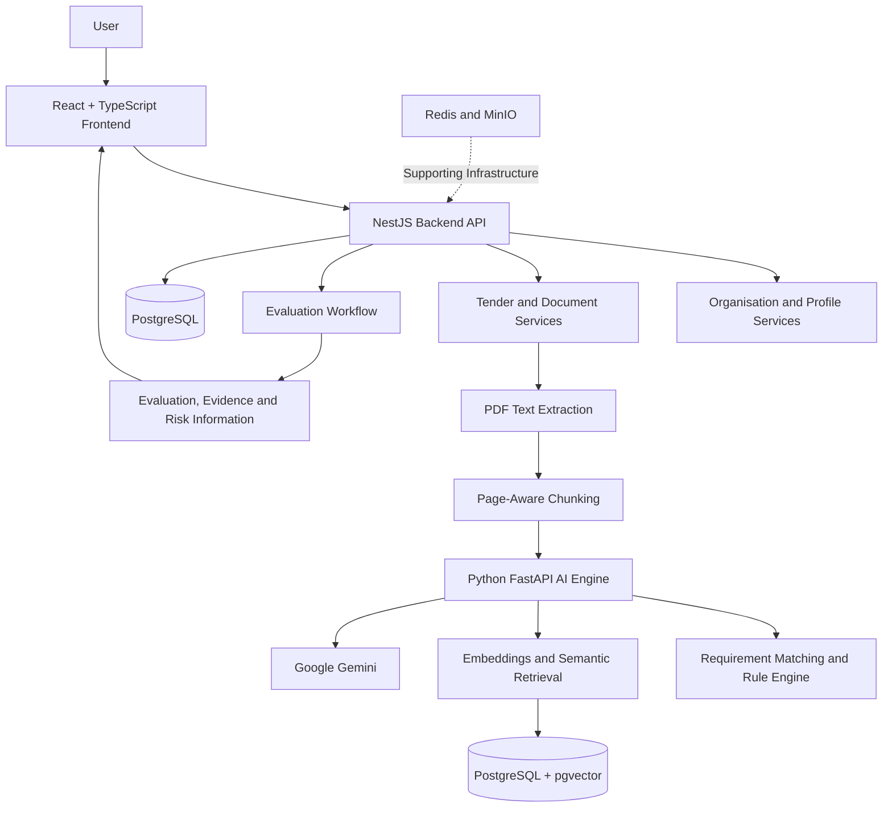
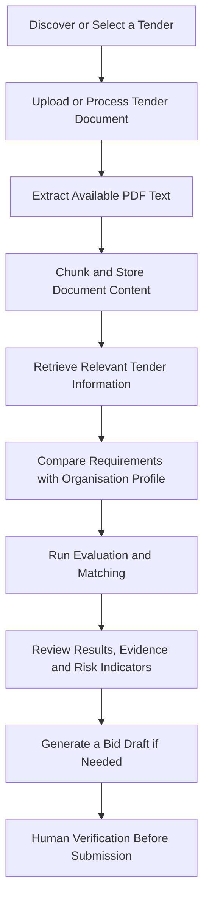

<div align="center">

# TenderIQ

### AI-Powered Procurement Intelligence for MSMEs

**Discover tenders. Understand requirements. Evaluate opportunities. Prepare bids with confidence.**

[GitHub Repository](https://github.com/AnanyaB27/TenderIQ)

</div>

---

## 📌 About TenderIQ

TenderIQ is an AI-assisted procurement intelligence platform designed to help Micro, Small, and Medium Enterprises (MSMEs) navigate government tender opportunities more efficiently.

Tender documents often contain lengthy eligibility conditions, technical specifications, financial requirements, and supporting-document instructions. TenderIQ brings tender discovery, document processing, organisational profiling, evaluation, evidence review, and bid-preparation support into one workflow.

The platform aims to reduce the manual effort involved in understanding procurement opportunities and help businesses make more informed bidding decisions. Evaluation results and generated bid content should be verified against the official tender documents before decisions or submissions are made.

## ✨ Key Features

### 🔎 Tender Discovery
- Tender discovery and search interface.
- CPPP (Central Public Procurement Portal) tender ingestion and normalisation.
- Structured tender information for review and downstream analysis.

### 📄 Tender Document Processing
- Upload and process supported PDF tender documents.
- Extract text from text-readable PDFs.
- Split extracted content into page-aware chunks and retain useful metadata.
- Persist document and chunk information for downstream analysis.

### 🏢 MSME Organisation Profile
- Maintain business context such as annual turnover, years of experience, operating locations, and core capabilities.
- Use available organisational information when assessing tender requirements.

### 🧠 AI-Assisted Evaluation and Matching
- Evaluate tender requirements against available organisation information.
- Combine AI-assisted extraction and analysis with deterministic rule-based checks and match scoring.
- Present structured evaluation results with evidence, risk indicators, and confidence-related information.
- Support reviewable, evidence-oriented procurement decisions.

### 🔗 Evidence and Semantic Retrieval
- Page-aware document chunking and metadata.
- Embedding and vector-storage infrastructure using PostgreSQL and pgvector.
- Semantic retrieval architecture to find relevant document content.
- Evidence and citation structures that help connect findings to supporting tender information.

### ✍️ AI-Assisted Bid Drafting
- Generate structured bid-response drafts using available tender context.
- Support bid preparation while leaving final verification to the user.

### 🧪 Evaluation Infrastructure
- Dataset schema, evaluation runner, and metrics infrastructure to support controlled testing and benchmarking.

## 🖥️ Technology Stack

| Layer | Technology | Role |
|---|---|---|
| Frontend | React, TypeScript, Vite | Web application and user workflows |
| Styling | Tailwind CSS | UI styling |
| Backend | NestJS, TypeScript | Application APIs and business logic |
| ORM | TypeORM | Database access |
| AI service | Python, FastAPI | Document intelligence and AI-related operations |
| Database | PostgreSQL | Persistent application data |
| Vector search | pgvector | Vector storage and semantic retrieval |
| Generative AI / embeddings | Google Gemini | Configured generative and embedding capabilities |
| Supporting services | Redis, MinIO | Caching and object/file storage where configured |
| Local orchestration | Docker Compose | Development service configuration |
| Version control | Git and GitHub | Source history and collaboration |

## 🏗️ System Architecture

TenderIQ separates the web interface, core application API, and AI-processing service into distinct components.



### Component Responsibilities

- **Frontend:** Tender discovery, organisation profile, document upload, evaluation results, and bid-drafting interfaces.
- **Backend API:** Application endpoints and services for authentication, organisations, tenders, documents, and evaluation-related operations.
- **AI Engine:** Document processing, extraction, chunking, embeddings, retrieval, matching, and drafting-related services.
- **PostgreSQL:** Stores structured application and processing data.
- **pgvector:** Supports vector storage and similarity-based retrieval.
- **Redis and MinIO:** Supporting infrastructure used according to the configured environment.

## 🔄 How TenderIQ Works



1. The user discovers or selects a tender.
2. A supported PDF is uploaded and processed.
3. The system extracts available text and organises it into chunks.
4. Document content and associated metadata are stored for downstream retrieval.
5. Relevant requirements are considered alongside the available MSME profile.
6. The evaluation workflow generates structured findings and matching information.
7. The user reviews the results and supporting evidence.
8. If needed, the user prepares a bid-response draft and verifies it before submission.

## 📁 Repository Structure

```text
TenderIQ/
├── frontend/                 # React + TypeScript + Vite web application
├── backend/                  # NestJS API and backend services
├── ai-engine/                # Python FastAPI AI and document-intelligence services
├── docs/                     # Project and engineering documentation
├── docker/                   # Docker and related infrastructure configuration
├── docker-compose.yml        # Local development service orchestration
├── docker-compose.prod.yml   # Production-shaped Compose configuration
├── .github/                  # GitHub configuration and templates
├── .gitignore                # Files excluded from version control
├── LICENSE                   # Project terms
└── README.md                 # Project overview and setup guide
```

## 🚀 Getting Started

### Prerequisites

- Git
- Node.js and npm compatible with the project
- Python 3.11 or a compatible version for the AI engine
- Docker and Docker Compose, if using the containerised setup
- PostgreSQL with pgvector support
- Google Gemini API credentials for features that use the configured AI provider

Redis and MinIO are included in the local Docker Compose configuration.

### 1. Clone the Repository

```bash
git clone https://github.com/AnanyaB27/TenderIQ.git
cd TenderIQ
```

### 2. Configure Environment Files

Example configuration files are provided for the backend and AI engine:

- `backend/.env.example`
- `ai-engine/.env.example`

Create local `.env` files from the relevant examples and configure values for your machine. Review the Compose configuration to understand which variables are loaded by each service.

**Never commit real API keys, passwords, OAuth secrets, JWT secrets, or other credentials.** Keep local `.env` files out of Git.

### 3. Start the Application

The root `docker-compose.yml` defines the local services, including PostgreSQL with pgvector, Redis, MinIO, the backend API, notification worker, AI engine, and frontend.

Review the Compose environment values and service configuration before running the stack. Verify that the frontend API URL and service ports match your local configuration.

```bash
docker compose up --build
```

### 4. Run Services Individually

The frontend and backend define scripts in their respective `package.json` files. To start the frontend development server:

```bash
cd frontend
npm install
npm run dev
```

The backend defines development and build scripts in `backend/package.json`. The AI engine dependencies are listed in `ai-engine/requirements.txt`; prepare its Python environment according to that file and the engine configuration.

Database migrations and required service configuration should be completed before using a fresh local database.

## ⚙️ Configuration

TenderIQ may require configuration for:

- PostgreSQL connection settings.
- Backend API port and frontend API base URL.
- AI Engine base URL and internal service token.
- Google Gemini API key.
- Redis connection URL.
- MinIO/object-storage endpoint and credentials.
- Authentication and OAuth settings where enabled.

Use the `.env.example` files as a reference. Keep development credentials local and do not publish secrets in the repository or in screenshots.

## 🧑‍💻 Git and GitHub Workflow

TenderIQ uses Git for version control and GitHub for repository hosting and team collaboration.

```bash
git status
git pull
git add .
git commit -m "Describe the change"
git push
```

For substantial features, use a feature branch and pull request where appropriate. Review changes before merging, use meaningful commit messages, and keep contributions aligned with the work completed by each team member.

## ⚠️ Limitations

- **Scanned/image-only PDFs:** OCR for scanned documents is not currently a verified end-to-end capability. The primary demonstrated document workflow relies on extractable PDF text.
- **Evaluation outputs:** Results depend on the source document, available organisation data, and configured evaluation logic. Human review is required.
- **Predictive win probability:** A validated machine-learning model for predicting tender-win probability is not part of the current scope.
- **Bid drafts:** Generated content is a drafting aid and is not guaranteed to be compliant or submission-ready.
- **Production deployment:** Production deployment, secrets management, and CI/CD require additional environment-specific configuration and validation.

## 🛣️ Future Enhancements

- More robust OCR for scanned tender documents.
- Expanded tender-source integrations.
- Improved compliance analysis and evidence traceability.
- Broader test datasets and measurable retrieval and matching benchmarks.
- More comprehensive bid-draft validation.
- Improved automated testing and deployment pipelines.
- Additional usability, monitoring, and performance improvements.

## 👥 Team Members & Individual Contributions

### Rishi Kodaganur — Backend & System Integration
- Developed the NestJS backend and integrated application APIs.
- Worked on database integration and TypeORM-based persistence.
- Contributed to the AI gateway and backend–AI engine integration.
- Worked on backend testing, request orchestration, and system integration.
- Contributed to frontend implementation and debugging.

### Mirza Burhan Baig — Frontend Development
- Developed the React-based user interface.
- Worked on tender and organisation profile workflows.
- Integrated frontend components with backend APIs.
- Implemented the presentation of tender evaluation results.
- Contributed to frontend integration and application usability.

### Ananya Biju — Research, Analysis & Evaluation
- Conducted literature reviews and identified the research gap.
- Contributed to requirements and data analysis.
- Worked on the evaluation methodology and assessment framework.
- Contributed to project documentation and research paper preparation.

### 🤝 Team Collaboration

The team collaborated on integrating the frontend, backend, and AI-related components into a unified procurement-intelligence platform. Responsibilities were divided across individual modules, with shared efforts in testing, debugging, integration, and overall project development.

## 📄 Project Terms

Refer to the repository's `LICENSE` file for the project's terms.

---

<div align="center">

**TenderIQ — Making procurement intelligence more accessible to MSMEs.**

</div>
